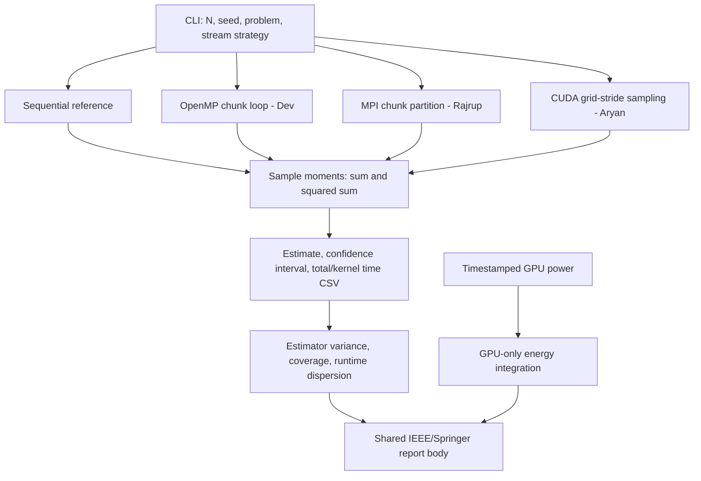

# System Architecture

Pi reference: quarter-circle indicator times four. Integration reference:
mean of coordinate squares. OpenMP uses a static parallel chunk loop and
reductions of both moments. MPI ranks own chunks rank, rank+size, ... and
combine both moments using MPI_SUM. Rank 0 reports maximum rank elapsed time.

The demonstration dashboard is served on localhost by scripts/demo_server.py.
It validates bounded inputs, invokes fixed executable paths without a shell,
and converts their CSV output to chart data. A single-run lock prevents
simultaneous dashboard experiments. No external frontend dependencies are needed.
