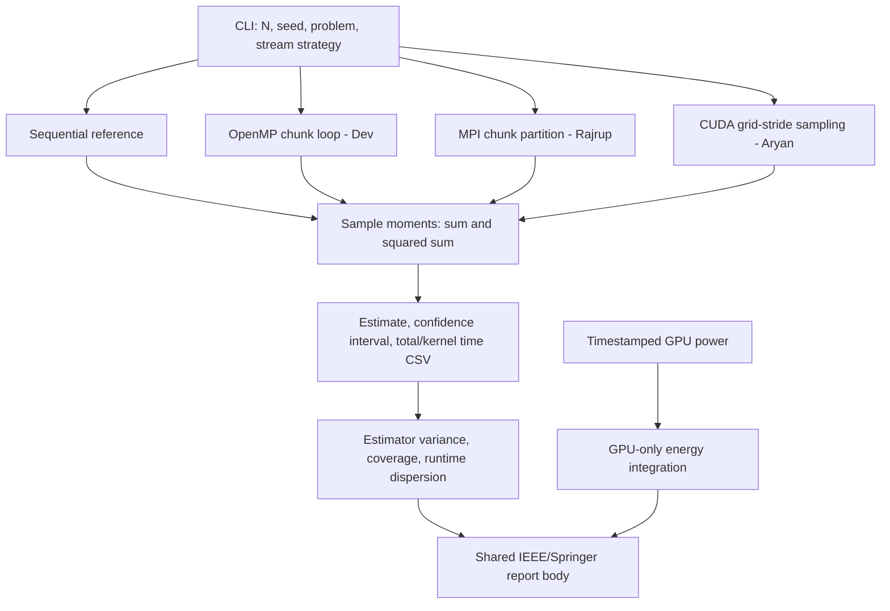

# System Architecture

Pi reference: quarter-circle indicator times four. Integration reference:
mean of coordinate squares. OpenMP/MPI are currently reference skeletons;
their TODOs implement worker ownership and moment reduction.
